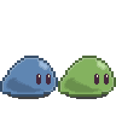

<div align="center">


<!-- 🕵️ You opened the source. Respect. Lab log #1 (base64): RkxBR3tzbDFteV8=  — log #2 is hidden inside the banner. -->

[](https://linkedin.com/in/alexia-regnier-7b88943a0)
[](mailto:regnieralexia13@gmail.com)

</div>

---

## 🎮 Player profile

<table>
<tr>
<td width="140" align="center">

<br/><sub><b>NightKiiro</b></sub>
</td>
<td>

| | |
|---|---|
| **Name** | Alexia |
| **Class** | Student developer · Epitech Marseille (Bachelor, 2nd year) |
| **Main quest** | Cybersecurity: blue team, observability & detection engineering |
| **Side quests** | Game dev, pixel art, front-end with a bit of motion |
| **Home base** | Ubuntu 🐧 |
| **Also** | I review first-year students' project defenses at Epitech |

</td>
</tr>
</table>

## 📜 Quest log

| | Quest | What I'm doing | Stack | Status |
|---|---|---|---|---|
| 🛡️ | **Sentinel X** | Turning a vulnerable support app into something observable: structured JSON logs, metrics, dashboards, then writing my own intrusion detection rules | Wazuh · Prometheus · Grafana · Docker | 🔨 in progress |
| 🧠 | **Codename** | Exploring prompt injection on a locally hosted LLM | Ollama · Python | 🔨 in progress |
| 🟢 | **Slimy** | A Java platformer where you control two slimes that merge and split to escape a lab (yes, the ones in the banner). Team of 3, 10 levels. I draw the sprites, make the music and the retro arcade title screen | Java · Pixelorama | 🔨 in progress |
| 🎰 | **La Cave** | A virtual casino with play-money chips, side project with a friend. I'm on the front: a cinematic scroll from a night street down into the gaming hall | JavaScript · GSAP · Lenis | 🔨 in progress |
| 🧃 | **[Hack and Juice](https://github.com/NightKiiro/Projet_Epitech_Hack-And-Juice)** | Finding and exploiting web vulnerabilities | Web security | ✅ done |

<sub>Earlier Epitech quests: [E-todo](https://github.com/NightKiiro/Projet_Epitech_E-todo) · [API Hackathon](https://github.com/NightKiiro/API-Hackathon) · [YOWL Product Design](https://github.com/NightKiiro/Projet_Epitech_YOWL-Product-Design) · [Hackathon Product Design](https://github.com/NightKiiro/Projet_Epitech_Hackathon-Product-Design)</sub>

## 🌳 Skill tree

**🛡️ Security & ops**
<br/>
 &nbsp;+ Wazuh

**💻 Dev**
<br/>


**🎨 Creative**
<br/>
 &nbsp;+ GSAP · Lenis · Pixelorama

---

## 🧪 Escape the Lab — a tiny playable adventure

> You are **Subject #2**, a small blue slime in a containment tube.
> The alarm is off. The scientist is on a coffee break.
> **Click to make your choices.**

<details>
<summary><b>▶ START GAME</b></summary>

<br/>

The glass cracks. You ooze out onto the cold floor. Ahead of you: a **locked door**, a **terminal** blinking in the dark, and a **ventilation grate**.

<details>
<summary>🖥️ Walk up to the terminal</summary>

<br/>

```
SUPPORTDESK v2.3 — RESTRICTED
login: _
```

<details>
<summary>⌨️ Type <code>admin / admin</code></summary>

<br/>

```
[ALERT] Failed login detected — rule #4012 triggered
[ALERT] Sentinel X: brute-force pattern, source = slime
```

🚨 Red lights everywhere. The blue team saw you coming (I wrote those detection rules).

**💀 GAME OVER** — *close ▶ START GAME and try again.*

</details>

<details>
<summary>📝 Read the sticky note on the screen first</summary>

<br/>

> *"Password = the name of the game I'm building. Lowercase. — A."*

<details>
<summary>⌨️ Type <code>slimy</code></summary>

<br/>

```
ACCESS GRANTED. Door 2B: UNLOCKED
```

The door slides open… but a laser grid blocks the corridor. Behind you, a green slime oozes out of the next tube. *Hi.*

<details>
<summary>🟦🟩 Merge with the green slime</summary>

<br/>

<p align="center"></p>

Together you're big enough to sit on the pressure plate. The grid shuts down. You split again, slide through, and the exit opens.

### 🎉 YOU ESCAPED!

🏆 *Achievement unlocked: **Lab Escapee*** — now go read the [quest log](#-quest-log) to see what else was built in this lab.

</details>

<details>
<summary>🏃 Rush through the lasers alone</summary>

<br/>

Zap. You're now a very small puddle.

**💀 GAME OVER** — *hint: you're not the only slime in this lab.*

</details>

</details>

</details>

</details>

<details>
<summary>🌀 Squeeze into the ventilation grate</summary>

<br/>

It's dark, dusty and full of cables. You crawl for a long time… and fall right into the **server room**. One screen shows a dashboard full of graphs.

<details>
<summary>👀 Look at the dashboard</summary>

<br/>

`CPU 12% · RAM 41% · failed_logins: 0 · anomalies: 1 (blue, gelatinous, in vent C)`

You've been spotted by monitoring. Somebody here takes observability seriously. 👋

**💀 GAME OVER** — *the terminal path might be smarter…*

</details>

</details>

</details>

---

## 🚩 Hidden flag

There's a flag hidden in this profile, split in two pieces. Format: `FLAG{...}`.
Find it, decode it, and send it to me on LinkedIn to earn my eternal respect and a spot in the hall of fame.

**Hall of fame:** *nobody yet… 👀*

---

## 📊 Lab monitoring

<p align="center">
  
  
</p>

<p align="center">
  <picture>
    <source media="(prefers-color-scheme: dark)" srcset="https://raw.githubusercontent.com/NightKiiro/NightKiiro/output/slime-trail-dark.svg" />
    
  </picture>
</p>

<div align="center">

<br/>
<sub>Sprites drawn by me in Pixelorama. Built by a slime that escaped — probably still in the vents.</sub>
</div>
