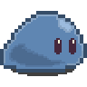
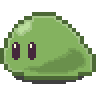

<!-- 🕵️ You opened the source. Respect. Lab log #1 (base64): RkxBR3tzbDFteV8=  — log #2 is hidden inside the banner. -->

---

## 🎮 Player profile

<table>
<tr>
<td width="140" align="center">

 <b>NightKiiro</b>
</td>
<td>

| | |
|---|---|
| **Name** | Alexia |
| **Class** | Student developer · Epitech Marseille (Bachelor, 2nd year) |
| **Main quest** | Cybersecurity: blue team, observability & detection engineering |
| **Side quests** | Game dev, pixel art, front-end with a bit of motion |
| **Home base** | Ubuntu 🐧 |
| **Also** | I review first-year students' project defenses at Epitech |

</td>
</tr>
</table>

## 📜 Quest log

| | Quest | What I'm doing | Stack | Status |
|---|---|---|---|---|
| 🛡️ | **Sentinel X** | Turning a vulnerable support app into something observable: structured JSON logs, metrics, dashboards, then writing my own intrusion detection rules | Wazuh · Prometheus · Grafana · Docker | 🔨 in progress |
| 🧠 | **Codename** | Exploring prompt injection on a locally hosted LLM | Ollama · Python | 🔨 in progress |
| 🟢 | **Slimy** | A Java platformer where you control two slimes that merge and split to escape a lab (yes, the ones in the banner). Team of 3, 10 levels. I draw the sprites, make the music and the retro arcade title screen | Java · Pixelorama | 🔨 in progress |
| 🎰 | **La Cave** | A virtual casino with play-money chips, side project with a friend. I'm on the front: a cinematic scroll from a night street down into the gaming hall | JavaScript · GSAP · Lenis | 🔨 in progress |
| 🧃 | **[Hack and Juice](https://github.com/NightKiiro/Projet_Epitech_Hack-And-Juice)** | Finding and exploiting web vulnerabilities | Web security | ✅ done |

Earlier Epitech quests: [E-todo](https://github.com/NightKiiro/Projet_Epitech_E-todo) · [API Hackathon](https://github.com/NightKiiro/API-Hackathon) · [YOWL Product Design](https://github.com/NightKiiro/Projet_Epitech_YOWL-Product-Design) · [Hackathon Product Design](https://github.com/NightKiiro/Projet_Epitech_Hackathon-Product-Design)

## 🌳 Skill tree

**🛡️ Security & ops**
 
 &nbsp;+ Wazuh

**💻 Dev**
 

**🎨 Creative**
 
 &nbsp;+ GSAP · Lenis · Pixelorama

---

## 🧪 Play Slimy — right here

This is a real mini version of **Slimy**, the game I'm making at Epitech, and everyone who visits plays the **same board**.

**Rules:** both slimes get **the same move**. A slime that bumps into a wall stays put. Use the walls to bring them together: when they land on the same tile they **merge** into one big slime. Get the big slime to the **EXIT** to clear the level.

**How to play:** click an arrow. It opens a ready-made issue: just press *Submit*. A GitHub Action plays your move and updates the board within about a minute.

<!-- SLIMY:START -->

  

<table align="center">
<tr><td></td><td align="center"><a href="https://github.com/NightKiiro/NightKiiro/issues/new?title=slimy%7Cmove%7Cup&body=Just+press+Submit!+Your+move+is+played+automatically+in+about+a+minute.">⬆️</a></td><td></td></tr>
<tr><td align="center"><a href="https://github.com/NightKiiro/NightKiiro/issues/new?title=slimy%7Cmove%7Cleft&body=Just+press+Submit!+Your+move+is+played+automatically+in+about+a+minute.">⬅️</a></td><td align="center">move</td><td align="center"><a href="https://github.com/NightKiiro/NightKiiro/issues/new?title=slimy%7Cmove%7Cright&body=Just+press+Submit!+Your+move+is+played+automatically+in+about+a+minute.">➡️</a></td></tr>
<tr><td></td><td align="center"><a href="https://github.com/NightKiiro/NightKiiro/issues/new?title=slimy%7Cmove%7Cdown&body=Just+press+Submit!+Your+move+is+played+automatically+in+about+a+minute.">⬇️</a></td><td></td></tr>
</table>

<a href="https://github.com/NightKiiro/NightKiiro/issues/new?title=slimy%7Creset&body=Just+press+Submit!+Your+move+is+played+automatically+in+about+a+minute.">🔄 restart this level</a> · 0 moves played · 0 levels cleared by the community

<!-- SLIMY:END -->

Under the hood: issue → GitHub Action → Python script (no dependencies) → new board SVG with my Pixelorama sprites → commit. Source in [`game/`](game/).

---

## 🚩 Hidden flag

There's a flag hidden in this profile, split in two pieces. Format: `FLAG{...}`.
Find it, decode it, and send it to me on LinkedIn to earn my eternal respect and a spot in the hall of fame.

**Hall of fame:** *nobody yet… 👀*

---

## 📊 Lab monitoring

  
  

  <picture>
    <source media="(prefers-color-scheme: dark)" srcset="https://raw.githubusercontent.com/NightKiiro/NightKiiro/output/slime-trail-dark.svg" />
    
  </picture>

 
Sprites drawn by me in Pixelorama. Built by a slime that escaped — probably still in the vents.

